# Rust UI Benchmark for Windows

A reproducible comparison of thirteen desktop UI stacks under the lifecycle of
a resident Windows quick launcher:
[Tauri/WebView2](https://github.com/tauri-apps/tauri),
[Slint](https://github.com/slint-ui/slint),
[zgui](https://github.com/zortax/zgui),
[Dioxus Desktop](https://github.com/DioxusLabs/dioxus),
[Dioxus Native/Blitz](https://github.com/DioxusLabs/blitz),
[gpui-ce](https://github.com/gpui-ce/gpui-ce),
[Iced](https://github.com/iced-rs/iced),
[gpui-kit](https://github.com/longbridge/gpui-kit),
[KAS](https://github.com/kas-gui/kas),
[Makepad](https://github.com/makepad/makepad),
[FerroUI](https://github.com/wieslawsoltes/FerroUI),
[egui](https://github.com/emilk/egui), and
[gpui-fast](https://github.com/longbridge/gpui-fast). The current results use
the corrected unmanaged-window protocol and a common environment baseline.
Frameworks are tested serially with an isolated Cargo home and target directory
removed only after durable results pass validation.

This repository is Windows-specific. The harness verifies native HWNDs and
uses Windows process, GPU engine, and GPU process-memory performance counters.

## Why this benchmark exists

The author built this benchmark to choose a Rust GUI stack for possible UI
refactors of two resident Windows applications:

- [ClipboardXt](https://github.com/more-14-different/clipboardxt), currently a
  WPF application, combines a searchable clipboard history, a folder-jump
  panel, and an Everything-backed File Explorer quick-find panel. It handles
  text, images, and files; uses several cooperating windows and popups; and is
  designed for keyboard-first, focus-preserving interaction.
- [komorebi-shortcuts-tauri](https://github.com/kkRelation/komorebi-shortcuts-tauri),
  currently a Tauri/WebView2 application, is a
  searchable command palette for live Komorebi, Kanata, ErgoNav, AHK, and
  shell shortcuts. It starts hidden and adds no-activate auxiliary windows for
  the selected item's preview and keyboard-binding atlas.

Both applications spend most of their lifetime in the background, then must
pop out promptly on demand, search and update selection-dependent UI without
perceptible delay, coordinate multiple native windows without stealing focus,
and return to a low-resource hidden state. This makes hidden RAM and idle
activity, warm show/hide latency, multi-window behavior, and sustained update
cost product requirements rather than synthetic benchmark trivia.

Neither production application is a contestant. Each reduced probe owns the
same two-window scene and shared selection state, so the experiment isolates
framework/runtime cost. It does not compare the applications' database,
Everything integration, or full search pipelines; those remain separate
product-level concerns when choosing a framework.

## Latest 13-framework results

The first twelve rows are three-release-round medians from 2026-10-29;
gpui-fast is a three-round extension measured on 2026-10-31 under the same
machine, power plan, protocol, and exact-title komorebi exclusions. Screenpipe
was exited during both measurement sessions (manually for the earlier rows and
automatically for gpui-fast). The two-day separation remains a minor cross-run
limitation.

Lower is better in every numeric column. Red values are overall minima
(including ties); blue values are lower than gpui-fast but are not the overall
minimum. The gpui-fast row is the comparison baseline. Select the image to
open the full-size SVG.

[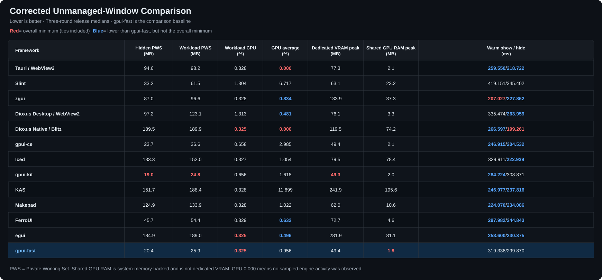](docs/assets/comparison/overview.svg)

These are machine- and scene-specific observations. In particular, the GPU
counter is sampled at Windows process/engine resolution, and the frameworks use
different retained-mode, rendering, and shader-cache strategies.

### Per-dimension and composite ranking

The heatmap makes every dimension's rank directly visible. RAM is the equal
mean of hidden-PWS and workload-PWS percentile rank scores. Ties use their
average rank.

[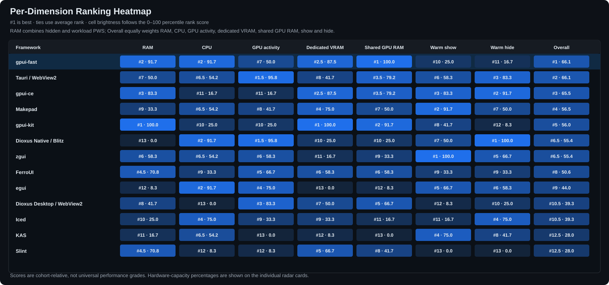](docs/assets/comparison/ranking-heatmap.svg)

The composite is an equal-weight arithmetic mean of seven cohort-relative
percentile rank scores: RAM, workload CPU, workload GPU activity, dedicated
VRAM, shared GPU memory, warm show, and warm hide. Shared GPU memory is backed
by system RAM and is kept separate from dedicated VRAM. This is a transparent
default—not a universal answer—and the generator accepts custom weights. The
weakness floor is the lowest axis score and helps distinguish a balanced
framework from one whose average hides a sharp weakness.

[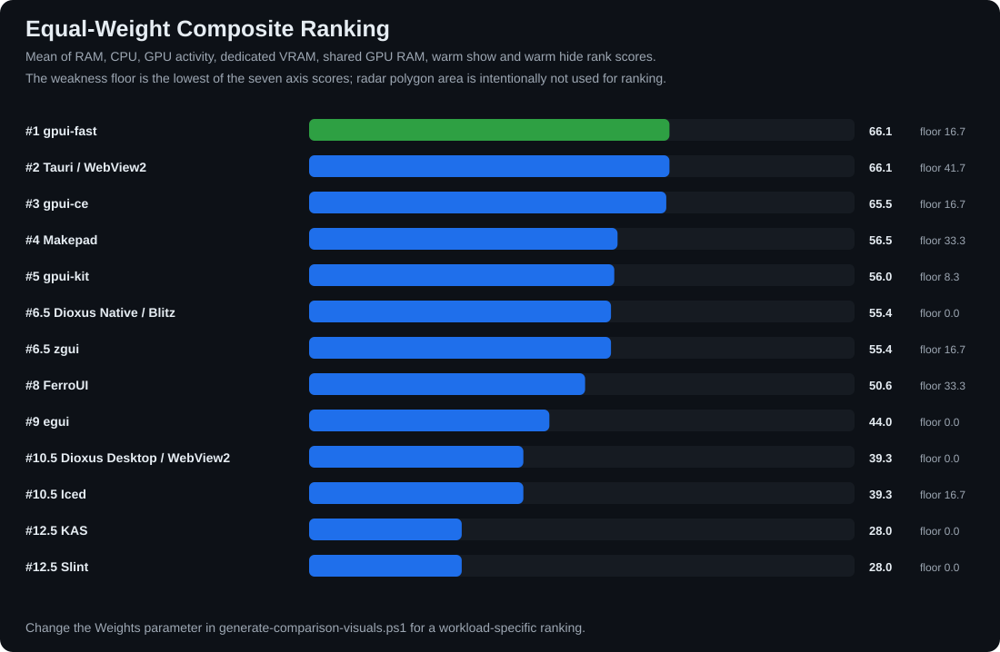](docs/assets/comparison/overall-ranking.svg)

### Why some axis scores are very low

An axis score is cohort-relative, not an absolute grade. A score of 0 means
"last among these thirteen measurements"; it does not mean that the framework
has zero capability or that the raw result is unusable. The list below includes
every axis score at or below 25 so that a good composite cannot hide a sharp
weakness. Raw inputs and scores come from
[`comparison-data.json`](docs/assets/comparison/comparison-data.json).

The explanations deliberately distinguish measured facts from causal
attribution. Windows GPU activity here is the
[per-timestamp sum](harness/measure-process-tree.ps1) of every matching
process-tree engine/adapter counter, whereas
[Task Manager represents a process by its busiest engine](https://devblogs.microsoft.com/directx/gpus-in-the-task-manager/).
Warm latency is also end-to-end: command delivery, framework event-loop work,
both HWND transitions, compositor/OS work, and
[5 ms harness polling](harness/measure-resident.ps1) are all included.
Consequently, an engine trace or CPU/GPU profiler is required where the table
says that the root cause is not isolated.

| Framework | Low axes (score; raw input) | What the evidence does and does not establish |
|---|---|---|
| gpui-fast | warm show 25 (319.336 ms); warm hide 16.667 (299.870 ms) | The accepted probe uses the normal native D3D11/DirectComposition path and both HWNDs reached the required states. The benchmark did not trace how much latency came from gpui-fast, DirectComposition, the OS transition, or polling. These are relative latency weaknesses, not evidence of a rendering or idle-resource problem. |
| gpui-ce | workload CPU 16.667 (0.658% machine); GPU activity 16.667 (2.985%) | The cost appears only while the common 50 Hz selection workload drives both windows. Idle checkpoints return to the counter floor. No CPU stack or GPU-engine trace was captured, so the split between scene rebuild, command generation, rendering, and presentation remains unknown. |
| gpui-kit | workload CPU 25 (0.656%); GPU activity 25 (1.618%); warm hide 8.333 (308.871 ms) | This is gpui-kit's normal gpui-pre application/root-component/asset path, not a browser shell. The measured costs are repeatable, but no profile isolates framework work from renderer and Windows presentation work; warm hide includes both native windows and harness observation. |
| Dioxus Native / Blitz | RAM 0 (189.5/189.9 MB hidden/workload PWS); dedicated VRAM 25 (119.5 MB); shared GPU memory 25 (74.2 MB) | The pinned alpha/beta native stack creates [two Blitz window renderers and two VDOMs](probes/dioxus-native-probe/src/main.rs), synchronized from one selection channel. That topology is a concrete source of duplicated per-window state, but the benchmark did not attribute the footprint among VDOMs, renderer/device state, swapchains, glyph/image caches, and allocator retention. |
| zgui | dedicated VRAM 16.667 (133.9 MB) | The value is the peak process allocation after both native windows and their render resources exist. Fast show/hide and modest CPU do not cancel that allocation, but the Windows counter cannot distinguish swapchain surfaces from renderer caches; no allocation trace was taken. |
| egui | RAM 8.333 (184.9/189.0 MB PWS); dedicated VRAM 0 (281.9 MB); shared GPU memory 8.333 (81.1 MB) | The probe explicitly uses eframe's WGPU renderer with a root viewport and one deferred native viewport. The counters establish a large two-viewport WGPU footprint on this machine, but do not identify how much belongs to swapchains, staging/belt buffers, texture/glyph caches, the adapter, or retained allocator pages. |
| Dioxus Desktop / WebView2 | workload CPU 0 (1.313%); warm show 8.333 (335.474 ms); warm hide 25 (263.959 ms) | The whole-tree measurement includes the two WebView2 renderer processes and the other WebView runtime processes, while each selection update crosses into both DOMs. This explains why the metric includes more than the Rust host, but no ETW/profile trace apportioned the CPU or latency among Dioxus diffing, IPC, WebView rendering, and window/compositor work. |
| Iced | RAM 25 (133.3/152.0 MB PWS); shared GPU memory 16.667 (78.4 MB); warm show 16.667 (329.911 ms) | The accepted probe uses Iced's normal WGPU/DX12 multi-window path. The data establishes the resident and GPU-backed footprint plus end-to-end show time; it does not isolate WGPU device/surface allocations, caches, framework state, driver allocation policy, or Windows transition time. |
| KAS | RAM 16.667 (151.7/188.4 MB PWS); GPU activity 0 (11.699%); dedicated VRAM 8.333 (241.9 MB); shared GPU memory 0 (195.6 MB) | KAS uses its normal WGPU/DX12 runner, and the high activity is confined to the common 400 x 20 ms two-window update phase. These are stable machine/scene observations, not a general KAS claim. No frame/engine or allocation profile was captured, so redraw scope, surface strategy, caches, and driver behavior remain candidate causes rather than conclusions. |
| Slint | workload CPU 8.333 (1.304%); GPU activity 8.333 (6.717%); warm show/hide 0 (419.151/345.402 ms) | The probe's default Slint 1.16.1 features select Winit + FemtoVG/OpenGL. Every 20 ms the [probe changes selection-dependent content in both windows](probes/slint-probe/src/main.rs); that [FemtoVG 1.16.1 render path](https://github.com/slint-ui/slint/blob/v1.16.1/internal/renderers/femtovg/lib.rs) clears the full surface and traverses component items before presentation. This directly explains frequent whole-window GPU work, although only a GPU trace can apportion individual engines. The earlier PID-reuse-contaminated sample was excluded; the accepted three one-process rounds retain the same pattern. Show/hide remains an end-to-end result with no framework/OS breakdown. |

Tauri, Makepad, and FerroUI have no axis at or below this explicit threshold;
their non-leading dimensions and implementation caveats remain visible in the
heatmap, raw JSON, and detailed notes below.

### Individual capability radars

Each framework gets its own seven-axis radar so thirteen polygons never overlap.
Higher vertices are better. Radar polygon area is deliberately **not** used as
the composite score: area changes when the same axes are reordered, which
makes it unsuitable as a stable ranking formula.

<details>
<summary>Open the 13 individual radar charts</summary>

<table>
<tr><td>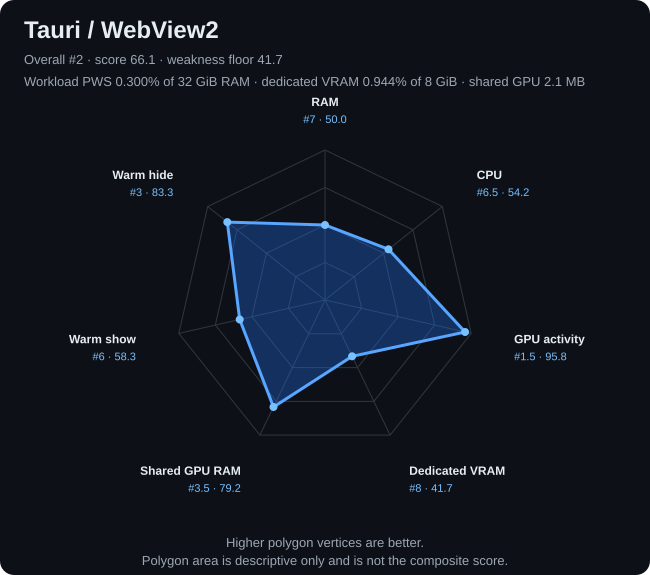</td><td>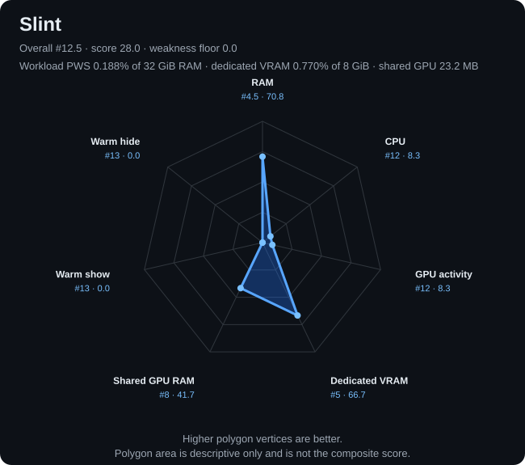</td></tr>
<tr><td>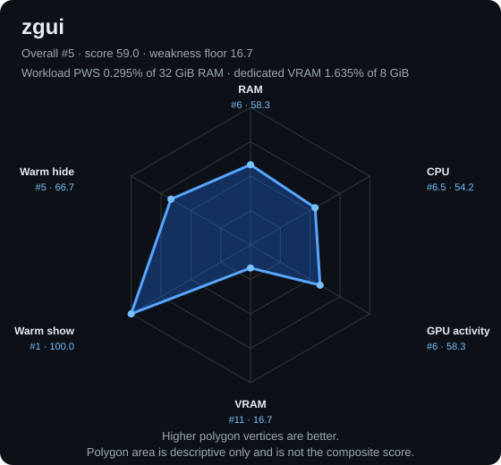</td><td>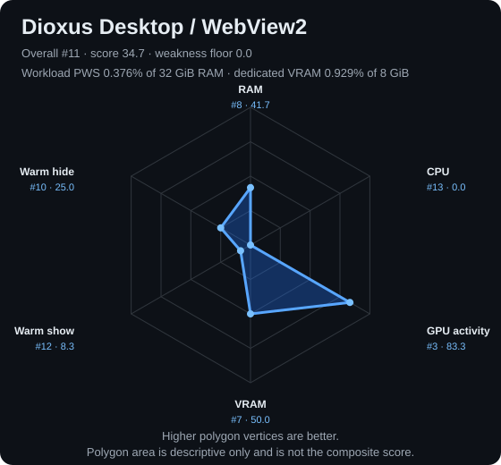</td></tr>
<tr><td>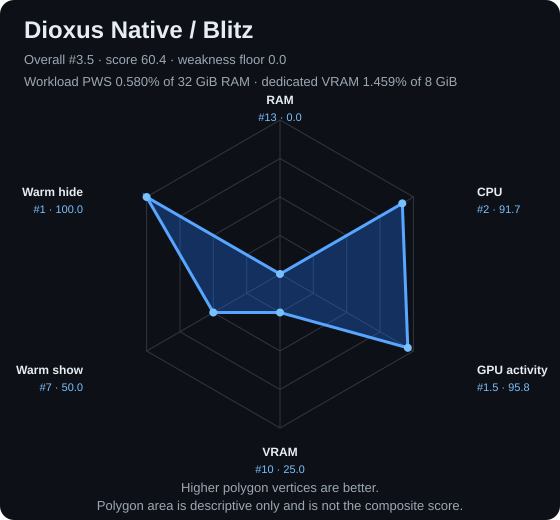</td><td>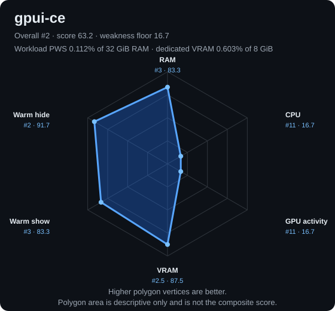</td></tr>
<tr><td>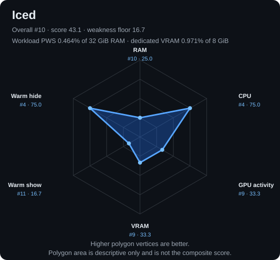</td><td>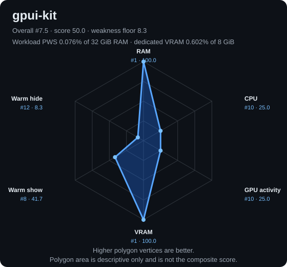</td></tr>
<tr><td>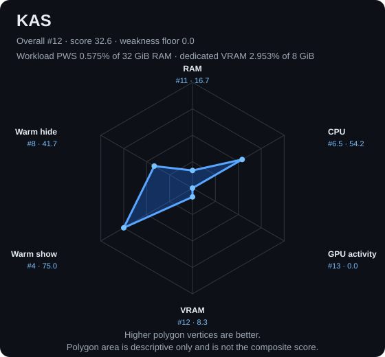</td><td>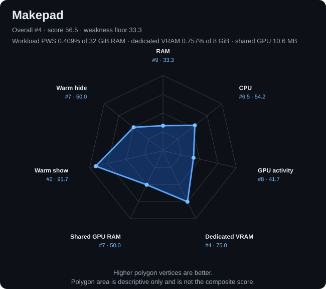</td></tr>
<tr><td>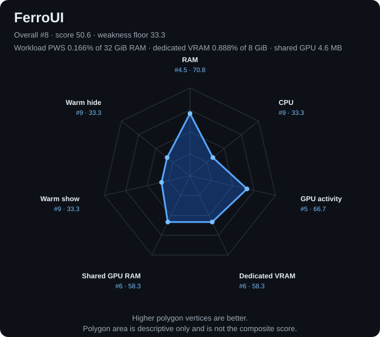</td><td>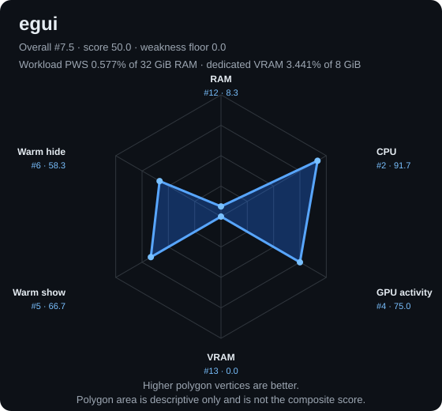</td></tr>
<tr><td>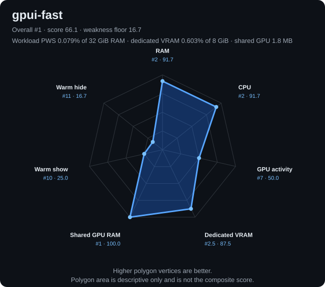</td><td></td></tr>
</table>

</details>

The radar cards also show workload PWS as a percentage of 32 GiB system RAM,
dedicated GPU allocation as a percentage of 8 GiB VRAM, and shared GPU memory
in MB. Those capacity figures are context, not score inputs: normalizing
directly against 32/8 GiB would compress all frameworks near the top of the
chart and hide meaningful differences inside this cohort.

Regenerate every ranking visual and its machine-readable data with:

```powershell
just comparison-visuals
```

The implementation is
[`harness/generate-comparison-visuals.ps1`](harness/generate-comparison-visuals.ps1),
and the exact computed metrics, ranks, scores, weights, and hardware baseline
are saved in
[`comparison-data.json`](docs/assets/comparison/comparison-data.json). See
[`comparison-scoring.md`](docs/comparison-scoring.md) for the formula,
trade-offs, hardware-capacity interpretation, and custom-weight examples.

## Repository layout

- `probes/`: independent probe crates plus the shared protocol crate;
- `harness/`: build, measurement, result-merge scripts, and Pester tests;
- `results/2026-10-28/`: untouched raw data from the original experiment;
- `results/2026-10-29/`: audited compatibility-anchor and unmanaged-cohort results;
- `results/2026-10-31/`: gpui-fast smoke, three-round result, event logs, and isolation audit;
- `docs/`: benchmark design, report, and extraction provenance.

Every probe has its own `Cargo.lock`. Direct framework inputs are additionally
pinned in its manifest: Slint 1.16.1, zgui commit `951a0ea3`, Dioxus Desktop
0.7.10, Dioxus Native/Blitz commit `fe33b778`, gpui-ce commit `5cac1478`,
Tauri 2.12.5 (`tauri-build` 2.7.4), Iced 0.14.0, and gpui-kit 0.8.1
(resolving to gpui-pre 0.3.10). KAS, kas-wgpu, and kas-widgets are each
pinned to 0.17.0, with only WGPU's DX12 backend enabled. Makepad Widgets is
pinned to 1.0.0 and uses Makepad's native Windows D3D11 path. FerroUI is pinned
to the only published 0.4 crate, `0.4.0-preview.1`, using its default desktop
Fluent/Skia/ANGLE path. egui/eframe is pinned to 0.37.0 and explicitly uses
eframe's WGPU renderer. gpui-fast and gpui-fast-platform are pinned to 0.1.12;
the Windows path uses its native Direct3D 11/DirectComposition renderer.

## Protocol

Every probe starts hidden and remains alive until the harness sends `quit`.
One measured round performs:

1. hidden idle sampling;
2. warm show and visible idle sampling;
3. 400 shared-state updates, one every 20 ms;
4. warm hide, 15-second settlement, and hidden sampling;
5. 30 show/hide cycles and a final hidden sample.

The harness measures the whole process tree: Working Set, Private Working Set,
Private Bytes, CPU, GPU engine activity, GPU memory, process/renderer count,
artifact size, and end-to-end warm show/hide latency. See
[`docs/benchmark-design.md`](docs/benchmark-design.md) for the full contract.

## Requirements

- Windows 11;
- PowerShell 7;
- a Rust toolchain and Windows native build tools;
- Pester for the harness tests;
- `just` for the convenience recipes below.

## Build and test

From the repository root:

```powershell
just build
just test
```

The equivalent direct build command is:

```powershell
.\harness\build-all.ps1 -Configuration release
```

## Measure

Use a short debug lifecycle check after changing a probe or the harness:

```powershell
just smoke
```

Run the comparable three-round release experiment with:

```powershell
just measure
```

Local results are written under `results/local/`, which is ignored by Git.
For an explicitly numbered retry, combine `-Rounds 1` with `-RoundStart N`.
Use `harness/merge-resident-results.ps1` to assemble successful pairs while
retaining failed attempts for auditability.

For the disk-bounded expansion workflow, run exactly one framework at a time:

```powershell
just framework-test NAME
just framework-clean NAME
```

After the named probe is implemented and enabled, `framework-test` performs a
debug smoke run, a release build, three full release rounds, result validation,
and guarded cleanup. After the debug build it records and exits a running
`screenpipe-app.exe`; on both success and failure it restarts the original
executable with its original arguments and waits for `/health` to report
`healthy`. A failure preserves
`.benchmark-work/<framework>` and writes a terminal status JSON. The explicit
`framework-clean` recipe uses the same allow-listed path checks and is intended
for an accepted terminal outcome, not an incomplete result.

## Detailed current-result notes

### [Iced](https://github.com/iced-rs/iced) unmanaged-window result

Iced 0.14.0 with its WGPU renderer completed a debug smoke run and three valid
release rounds on 2026-10-29. Its median hidden/workload private working sets
were 133.3/152.0 MB; workload machine CPU was 0.327%, average GPU engine use
was 1.054%, and warm show/hide latency was 329.911/222.939 ms. Both native
windows retained the expected unmanaged outer sizes at every checkpoint.

The validated evidence is in
[`iced-unmanaged-attempt-3.json`](results/2026-10-29/iced-unmanaged-attempt-3.json)
and its adjacent event/status artifacts. The first two smoke attempts are kept
as diagnostics for an Iced/Winit same-process HWND enumeration deadlock; the
successful probe restricts lookup to the two exact titles and verifies their
PID before changing visibility. Guarded cleanup then removed only the isolated
Iced work root and recovered 3,280,015,360 bytes.

### [gpui-kit](https://github.com/longbridge/gpui-kit) unmanaged-window result

gpui-kit 0.8.1, backed by gpui-pre 0.3.10, completed a debug smoke run and
three valid release rounds on 2026-10-29. Its median hidden/workload private
working sets were 19.0/24.8 MB; workload machine CPU was 0.656%, average GPU
engine use was 1.618%, and warm show/hide latency was 284.224/308.871 ms. Both
native windows retained the expected 715x514 and 1215x794 unmanaged outer
sizes at all four checkpoints in every round. The probe uses gpui-kit's normal
application, root-component, and asset initialization path; dependency and
source inspection found no browser shell, QuickJS, or WebView runtime.

The validated evidence is in
[`gpui-kit-unmanaged-attempt-2.json`](results/2026-10-29/gpui-kit-unmanaged-attempt-2.json)
and its adjacent event/status artifacts. The preceding
[`gpui-kit-unmanaged.json`](results/2026-10-29/gpui-kit-unmanaged.json) is kept
only as a diagnostic: gpui-pre created both initially hidden HWNDs at the full
1920x1012 work area, so that otherwise complete run is not comparable. The
accepted probe normalizes the two HWND outer rectangles with per-window DPI
before emitting `ready-hidden`. Guarded cleanup removed only the isolated
gpui-kit work root and recovered 7,488,868,352 bytes.

### [KAS](https://github.com/kas-gui/kas) unmanaged-window result

KAS 0.17.0 with its normal WGPU/DX12 runner completed a debug smoke run and
three valid release rounds on 2026-10-29. Its median hidden/workload private
working sets were 151.7/188.4 MB; workload machine CPU was 0.328%, average GPU
engine use was 11.699%, and warm show/hide latency was 246.977/237.816 ms. The
workload GPU figure is notably high for this probe and renderer, but remains a
machine/scene observation rather than a general KAS claim. Both native windows
retained the exact 715x514 and 1215x794 outer sizes at every checkpoint.

The validated evidence is in
[`kas-unmanaged-attempt-2.json`](results/2026-10-29/kas-unmanaged-attempt-2.json)
and its adjacent event/status artifacts. The first [`kas.json`](results/2026-10-29/kas.json)
run is retained as a diagnostic: release rounds 1 and 3 passed, but round 2
caught KAS/Winit still performing the auxiliary window's initial show after
both HWNDs had been created. The accepted probe waits for both initial shows,
normalizes their DPI-aware outer rectangles, and requires 500 ms of stable
hidden state before emitting `ready-hidden`. Guarded cleanup removed only the
isolated KAS work root and recovered 3,313,897,472 bytes.

### [Makepad](https://github.com/makepad/makepad) unmanaged-window result

Makepad Widgets 1.0.0 with its native Windows D3D11 renderer completed a
debug smoke run and three valid release rounds on 2026-10-29. Its median
hidden/workload private working sets were 124.9/133.9 MB; workload machine CPU
was 0.328%, average GPU engine use was 1.022%, and warm show/hide latency was
224.070/234.086 ms. Hidden, post-hide, and post-cycle CPU/GPU medians were all
zero at the Windows sampling resolution. Both `MultiWindow` HWNDs retained the
exact 715x514 and 1215x794 outer sizes at every checkpoint.

The validated evidence is in
[`makepad.json`](results/2026-10-29/makepad.json) and its adjacent event/status
artifacts. Makepad 1.0.0 does not expose retained desktop visibility through
its public window API, so the probe uses a current-PID and exact-title Win32
adapter for show/hide, DPI-aware size normalization, and normal `WM_CLOSE`
shutdown. The scene still uses one Makepad process, one `MultiWindow`, and one
Rust selection value projected into both native windows; no WebView runtime is
present. Guarded cleanup removed only the isolated Makepad work root and
recovered 1,897,279,488 bytes.

### [FerroUI](https://github.com/wieslawsoltes/FerroUI) unmanaged-window result

FerroUI `0.4.0-preview.1` with its default desktop Fluent theme and Skia/ANGLE
renderer completed a debug smoke run and three valid release rounds on
2026-10-29. Its median hidden/workload private working sets were 45.7/54.4 MB;
workload machine CPU was 0.329%, average GPU engine use was 0.632%, and warm
show/hide latency was 297.982/244.843 ms. Both retained native windows kept the
exact 715x514 and 1215x794 outer sizes at all four checkpoints in every round.

The validated evidence is in
[`ferroui.json`](results/2026-10-29/ferroui.json) and its adjacent event/status
artifacts. FerroUI has no stable 0.4.0 release, so this result is explicitly a
prerelease result. The default Fluent path transitively brings its markup/XAML
tooling, but the probe does not enable FerroUI's facade `xaml`, Vello, WinUI,
diagnostics, ReactiveUI, or MVVM variants. Its upstream ANGLE link emits
LNK4217 import warnings; the locked build, smoke run, all three rounds, and
clean shutdown nevertheless succeeded. Guarded cleanup removed only the
isolated FerroUI work root and recovered 15,976,652,800 bytes.

### [egui](https://github.com/emilk/egui) unmanaged-window result

egui/eframe 0.37.0 with the WGPU renderer completed a debug smoke run and
three valid release rounds on 2026-10-29. Its median hidden/workload private
working sets were 184.9/189.0 MB; workload machine CPU was 0.325%, average GPU
engine use was 0.496%, and warm show/hide latency was 253.600/230.375 ms. Both
native viewports retained the exact 715x514 and 1215x794 outer sizes at all
four checkpoints in every round. Hidden, visible-idle, post-hide, and
post-cycle CPU/GPU medians were zero at the Windows sampling resolution.

The validated evidence is in
[`egui.json`](results/2026-10-29/egui.json) and its adjacent event/status
artifacts. The probe uses eframe's root viewport plus
`show_viewport_deferred` for the auxiliary window, one shared Rust selection
value, and an explicit WGPU renderer selection. A current-PID and exact-title
Win32 adapter synchronizes retained visibility using the same unmanaged-window
contract as the other expansion probes. The 14.2 MB executable and locked
dependency graph were identical across all rounds. Guarded cleanup removed
only the isolated egui work root and recovered 3,520,892,928 bytes.

### [gpui-fast](https://github.com/longbridge/gpui-fast) unmanaged-window result

gpui-fast 0.1.12 with its native Windows Direct3D 11/DirectComposition path
completed a debug smoke run and three valid release rounds on 2026-10-31. Its
median hidden/workload private working sets were 20.4/25.9 MB; workload machine
CPU was 0.325%, average GPU engine use was 0.956%, and warm show/hide latency
was 319.336/299.870 ms. Hidden, visible-idle, post-hide, and post-cycle CPU/GPU
medians were zero at the Windows sampling resolution. Post-cycle private
working set matched post-hide in every round, so the 30 visibility cycles did
not produce an observed retention increase in this probe.

The validated evidence is in
[`gpui-fast.json`](results/2026-10-31/gpui-fast.json) and its adjacent smoke,
event, and [`status`](results/2026-10-31/gpui-fast-status.json) artifacts. Both
HWNDs retained the exact 715x514 and 1215x794 unmanaged outer sizes at all four
checkpoints in every round. The status audit records both komorebi title rules,
Screenpipe suspension and healthy restoration, and guarded cleanup of only the
gpui-fast work root, which recovered 4,363,223,040 bytes. The 11.0 MB executable
and its SHA-256 were identical across all rounds.

## Archived data and provenance

Earlier managed-window artifacts remain under `results/2026-10-28/` for
traceability, but are intentionally excluded from this README's current result
table, commentary, and rankings. Their raw files retain paths from the source
repository; see [`docs/provenance.md`](docs/provenance.md).

The probe executable names and static fixture contain the original `komorebi`
identifier. They are preserved so the published result remains traceable to
the exact measured source; they are fixture labels, not dependencies on the
original application.

## License

This project is licensed under the [MIT License](LICENSE).

